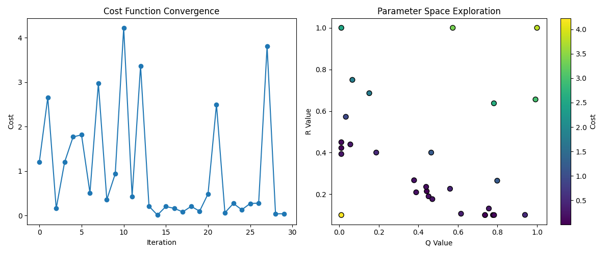
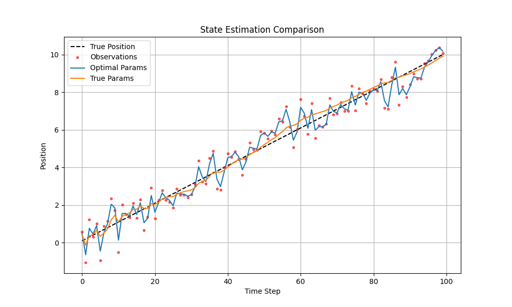

# KF Auto-Tuning

Python ベースのカルマンフィルタ自動チューニングライブラリ。
ベイズ最適化（ガウス過程）を用いてプロセスノイズ共分散 **Q** と観測ノイズ共分散 **R** を自動最適化します。

## 概要

カルマンフィルタの性能はノイズパラメータ (Q, R) の設定に大きく依存しますが、
実システムではこれらを正確に知ることは難しいです。本ライブラリは

- **NEES**（Normalized Estimation Error Squared）
- **NIS**（Normalized Innovation Squared）

という統計的一貫性指標を最小化するコスト関数をベイズ最適化で解くことで、
手動チューニングなしに最適な Q/R を探索します。

## インストール

```bash
pip install -e .
```

依存パッケージ（`pyproject.toml` で管理）:

| パッケージ | 用途 |
|---|---|
| `numpy` | 行列演算 |
| `pyyaml` | 設定ファイルの読み込み |
| `scikit-optimize` | ベイズ最適化（ガウス過程） |
| `matplotlib` | 結果の可視化 |

## クイックスタート

### 1. メインスクリプト（推奨）

```bash
# デフォルト設定で単一実験
python main.py

# 複合コスト（NEES + NIS）で実行
python main.py --cost combined

# 異なるシードで 5 回実験（統計的評価）
python main.py --multi 5

# カスタム設定ファイルを使用
python main.py --config path/to/my_config.yaml

# プロットなしで実行
python main.py --no-plot
```

### 2. モデル CLI（モデルを選択して実行）

```bash
# DefaultModel（NIS コスト）
python -m kf_auto_tuning.experiment --model default --plot

# AdvancedModel（NEES + NIS 複合コスト）
python -m kf_auto_tuning.experiment --model advanced --plot
```

### 3. スタンドアロンデモ（モジュール依存なし）

```bash
python mock/kf_autotune_sample1d.py
```

### 4. Python API

```python
from kf_auto_tuning import DefaultModel, AdvancedModel, ExperimentRunner

# DefaultModel（NIS コスト）で実行
model = DefaultModel()
result = model.run(plot=True)

# AdvancedModel（NEES + NIS 複合コスト）で実行
adv = AdvancedModel()
result = adv.run(plot=True)

# ExperimentRunner を直接使ってコスト関数タイプを指定
runner = ExperimentRunner(
    model.system_config,
    model.optimization_config,
    cost_type="combined",  # "nis" | "nees" | "combined"
)
result = runner.run_experiment(plot=True)

# 最適化パラメータの確認
print(result["optimized_params"]["optimal_Q"])
print(result["optimized_params"]["optimal_R"])
```

## 設定ファイル

`config/sample_config.yaml` を参照・編集してシステムを定義します。

```yaml
system_config:
  F: [[1, 0.1], [0, 1]]   # 状態遷移行列
  G: [[0], [1]]             # 入力行列
  H: [[1, 0]]               # 観測行列
  Q_true: [0.0, 0.0]       # 真のプロセスノイズ（対角要素）
  R_true: 0.5               # 真の観測ノイズ
  x0: [0, 1]                # 初期状態
  P0: [[1, 0], [0, 1]]     # 初期誤差共分散
  u: 0                      # 制御入力
  steps: 100                # シミュレーションステップ数
  nx: 2                     # 状態次元
  nz: 1                     # 観測次元
  data_seed: 42             # 再現性のための乱数シード

optimization_config:
  param_bounds:
    Q: [0.01, 1.0]          # Q の探索範囲
    R: [0.1, 1.0]           # R の探索範囲
  n_calls: 30               # 最適化反復回数
  opt_seed: 42              # 最適化の乱数シード
```

## コスト関数の種類

| タイプ | 説明 | 適用場面 |
|---|---|---|
| `"nis"` | NIS のみ（観測一貫性）| 真値不要・デフォルト |
| `"nees"` | NEES のみ（推定誤差一貫性）| 真値が利用可能な場合 |
| `"combined"` | NEES + NIS の合計 | より厳密なチューニング |

## ディレクトリ構成

```
kf-auto-tuning/
├── config/
│   └── sample_config.yaml      # デフォルト設定ファイル
├── kf_auto_tuning/
│   ├── __init__.py             # パブリック API エクスポート
│   ├── config.py               # SystemConfig / OptimizationConfig データクラス
│   ├── data_generator.py       # シミュレーションデータ生成
│   ├── kalman_filter.py        # カルマンフィルタ実装（NEES/NIS 計算含む）
│   ├── optimizer.py            # ベイズ最適化ラッパー（scikit-optimize）
│   ├── models.py               # DefaultModel / AdvancedModel
│   ├── experiment_runner.py    # ExperimentRunner・複数実験ユーティリティ
│   ├── experiment.py           # モデル選択 CLI
│   └── visualization.py        # 結果プロット
├── mock/
│   └── kf_autotune_sample1d.py # スタンドアロン 1D デモ
├── tests/
│   ├── test_config_loading.py
│   ├── test_data_generator.py
│   ├── test_kalman_filter.py
│   ├── test_experiment_runner.py
│   └── test_models.py
└── main.py                     # CLI エントリーポイント
```

## テストの実行

```bash
python -m pytest tests/ -v
```

## 実行例（出力イメージ）

最適化後の収束グラフ:



最適パラメータと真値パラメータによる追跡比較:


